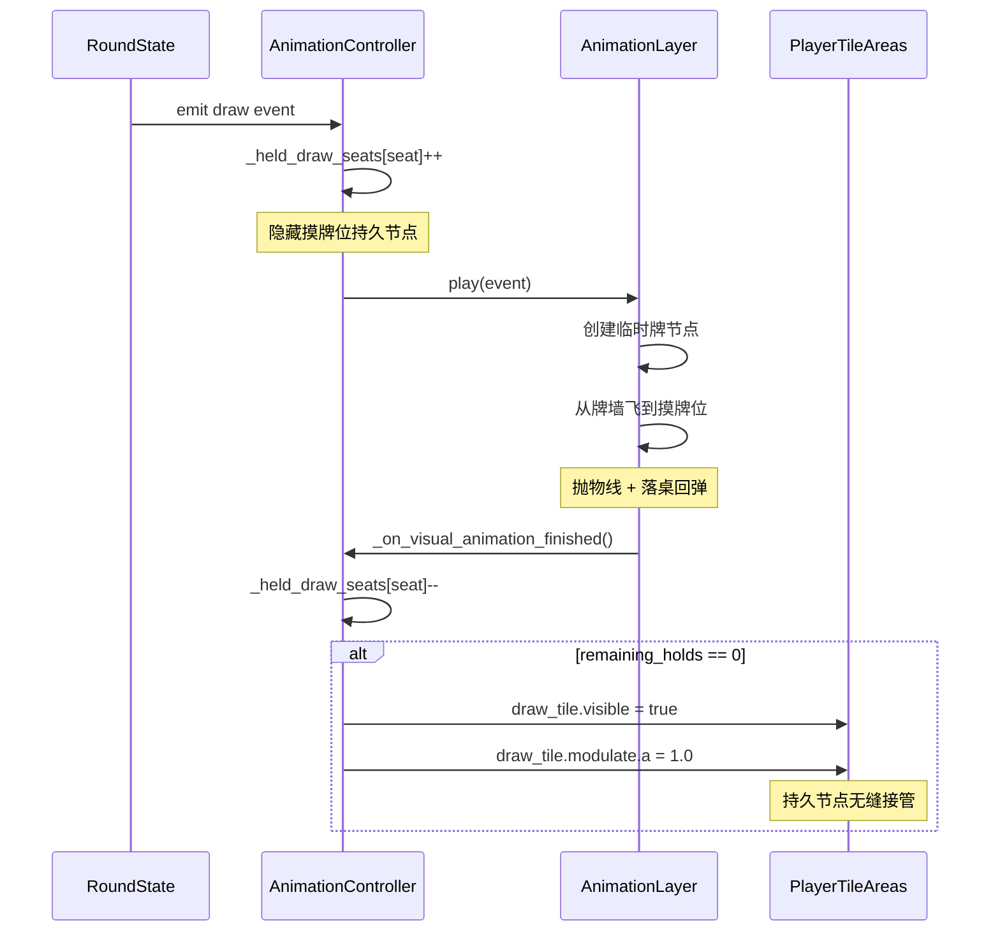
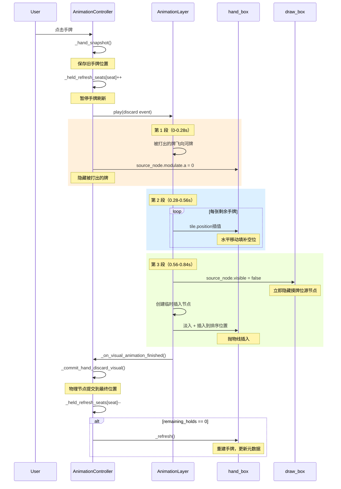
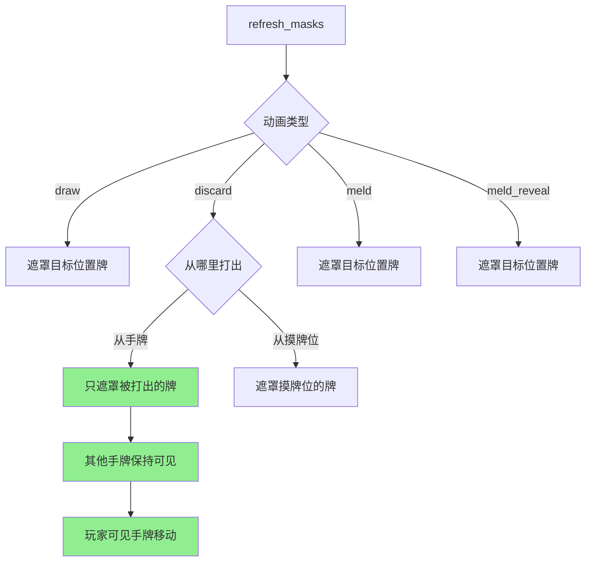
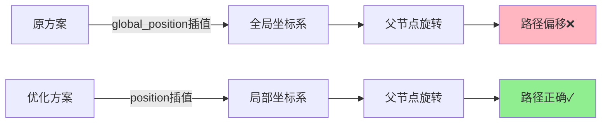

# 麻将动画流程图

## 摸牌动画流程



## 手牌出牌三段动画流程



## 遮罩控制逻辑



## 坐标系统优化



## 关键时序对比

### 优化前

```
出牌动画 (0.28s)
                  ↓
            手牌刷新（瞬间，从错误位置）
                  ↓
            所有牌闪烁❌
```

### 优化后

```
出牌动画 (0.28s)
                  ↓
        手牌移动填补空位 (0.28s)
                  ↓
        摸牌插入排序位置 (0.28s)
                  ↓
            提交物理节点✓
```

---

生成时间：2026-10-17  
工具：Codex AI
